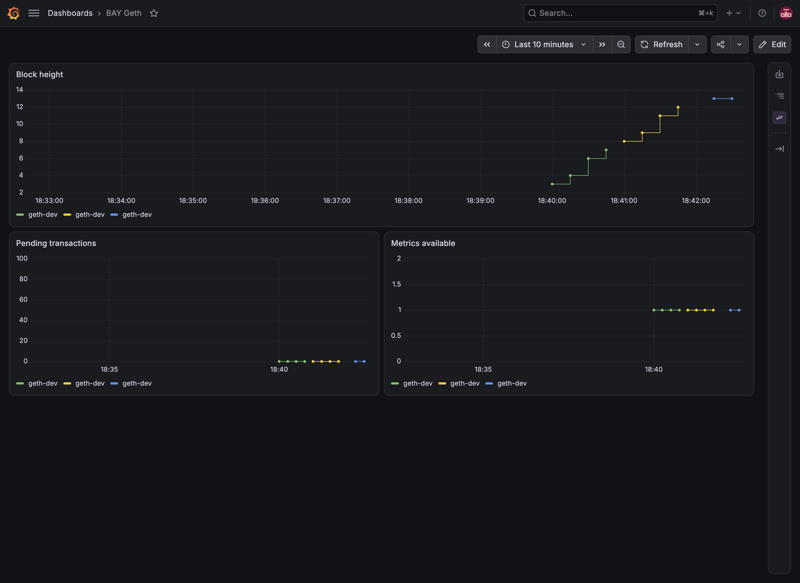
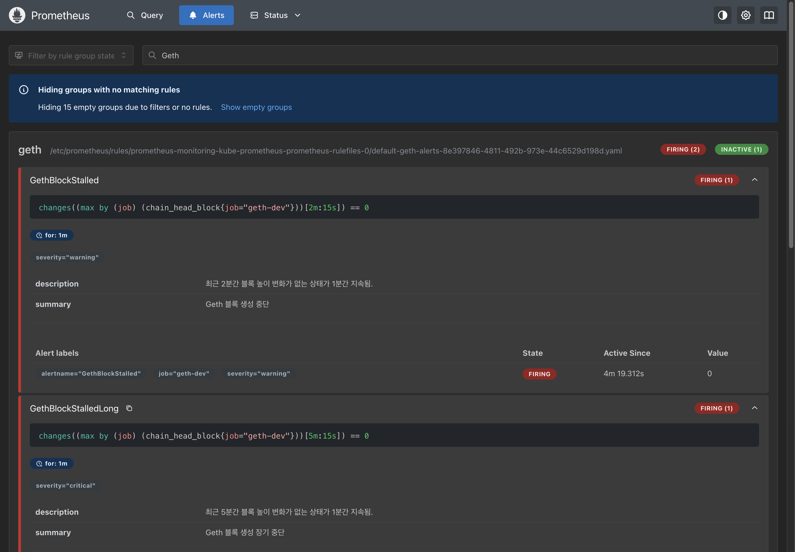
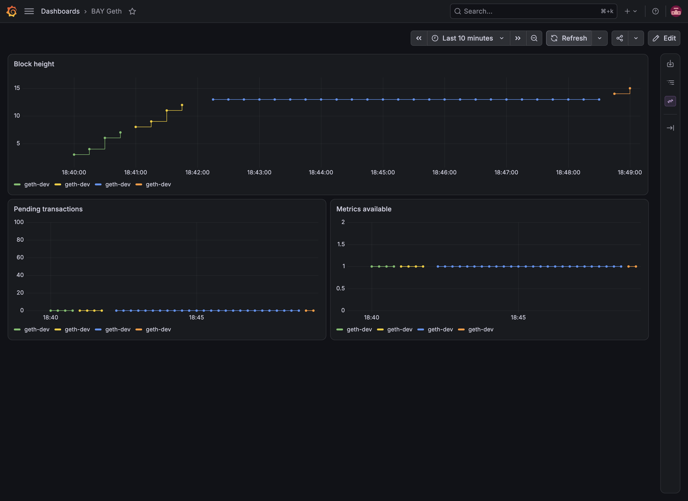

# 과제 3

## 한 것

Geth를 GitHub와 ArgoCD로 배포하고 Prometheus·Grafana를 연결했다. PR로 v1.17.4에서 v1.17.5로 올린 뒤, 블록 생성 중단과 Revert 복구를 확인했다. 수동으로 바꾼 파드 수가 Git 설정으로 돌아오는지도 측정했다.

## 배포 구성과 알람 기준

GitHub의 `k8s/`를 ArgoCD가 읽어 배포한다. Prometheus는 15초마다 메트릭을 수집하고, Grafana에서 블록 높이·pending tx·수집 상태를 본다. 체인 데이터는 PVC에 저장한다.

| 설정 | 이유 |
| --- | --- |
| 버전 태그 고정 | 같은 Git으로 배포 버전이 바뀌는 일을 줄인다. |
| selfHeal, prune | 수동 변경을 되돌리고 Git에서 지운 리소스를 정리한다. |
| release: monitoring | Helm으로 설치한 Prometheus가 수집 대상과 규칙을 찾게 한다. |
| warning | 2분간 블록 변화가 없는 상태가 1분 더 지속되면 울린다. |
| critical | 5분간 블록 변화가 없는 상태가 1분 더 지속되면 울린다. |

블록 주기가 12초라서 30초만 보고 판단하면 재시작이나 수집 지연도 장애로 볼 수 있다. 경고는 약 3분, 심각은 약 6분으로 잡았다. 메트릭 수집 실패는 `GethDown`으로 따로 감시한다.

## 증거

- [업그레이드 PR #1](https://github.com/jaesimin0903/bay-node-ops/pull/1)
- [장애 재현 PR #2](https://github.com/jaesimin0903/bay-node-ops/pull/2)
- [복구 Revert PR #3](https://github.com/jaesimin0903/bay-node-ops/pull/3)

RPC에서 v1.17.5를 확인했다. 블록 높이는 6에서 10으로 이어졌고 계정, 1번 블록 해시, PVC UID가 같았다. 교체 전후 수집 시각의 간격은 약 16초였다. 수집 주기가 15초이므로 이를 실제 서비스 중단 시간으로 보기는 어렵다.

장애 배포 후 블록은 13에서 멈췄다. 파드는 Running이고 ArgoCD도 Healthy였지만 블록 정지 알람은 울렸다. Revert 후 블록이 다시 오르고 두 알람이 해제됐다.

| 측정 구간 | 걸린 시간 |
| --- | --- |
| 장애 PR 머지 → warning Firing | 약 3분 13초 |
| 장애 PR 머지 → critical Firing | 약 6분 13초 |
| 복구 PR 머지 → 알람 해제 첫 관측 | 약 29초 |
| 수동 scale 0 → replicas 1 복원 | 약 0.38초 |
| 수동 scale 0 → 파드 Ready 복원 | 약 6.57초 |

Firing 시각은 Prometheus 원본 샘플로 계산했다. 해제는 5초 간격, selfHeal은 0.2초 대기와 API 조회로 관측한 값이다. selfHeal 시 새 파드가 생성됐고 ArgoCD 이벤트에 자동 동기화가 남았다.

## 막힌 점과 해결

3000번 포트에서 Grafana 대신 다른 프로젝트가 열렸다. 실행 중인 프로세스를 확인하고 Grafana를 3300번으로 옮겼다.

## CS 질문: 블록 높이에 increase()를 쓰지 않은 이유

블록 높이는 현재 상태를 나타내는 gauge다. 체인 재구성으로 낮아질 수도 있다. `increase()`와 `rate()`는 counter의 감소를 리셋으로 보정하므로 맞지 않는다. 이번에는 값이 바뀐 횟수를 세는 `changes()`로 정지를 판단했다. [Prometheus 함수 문서](https://prometheus.io/docs/prometheus/latest/querying/functions/)

파드가 교체되면 `instance`가 달라져 새 시계열이 생긴다. 먼저 `max by (job)`으로 파드별 라벨을 없앤 뒤 시간 범위를 적용해 교체 전후를 연결했다. 여러 독립 노드를 같은 job으로 묶으면 정상 노드가 다른 노드의 정지를 가릴 수 있어, 이 규칙은 단일 노드 실습에 맞춘 것이다.

## 리서치: selfHeal이 있으면 급한 수정은 어떻게 할까?

`kubectl scale`로 replicas를 0으로 바꿨지만 곧 1로 돌아왔다. ArgoCD가 Git과 클러스터의 차이를 고치고, Kubernetes 컨트롤러가 그 값에 맞춰 파드를 다시 만들었다. 원하는 상태를 계속 맞추는 두 조정 루프가 이어진 것이다. [ArgoCD 자동 동기화 문서](https://argo-cd.readthedocs.io/en/stable/user-guide/auto_sync/)

변경과 복구 과정을 PR로 남길 수 있는 점은 좋다. 대신 장애 중에 급하게 고친 값도 되돌아갈 수 있다. 임시 조치가 필요하면 자동 동기화 정책을 먼저 확인하고, 조치 후 Git에도 같은 내용을 반영해야 한다.

selfHeal을 끄면 수동 변경을 자동으로 되돌리지 않는다. prune을 끄면 Git에서 지운 리소스가 클러스터에 남을 수 있다. GitOps는 배포 명령을 줄여주지만, 어떤 상태를 정답으로 둘지는 운영자가 결정해야 한다.

클러스터와 PVC는 게임데이에 쓰도록 유지했다. 선택 과제인 텔레그램 알림은 연결하지 않았다.
